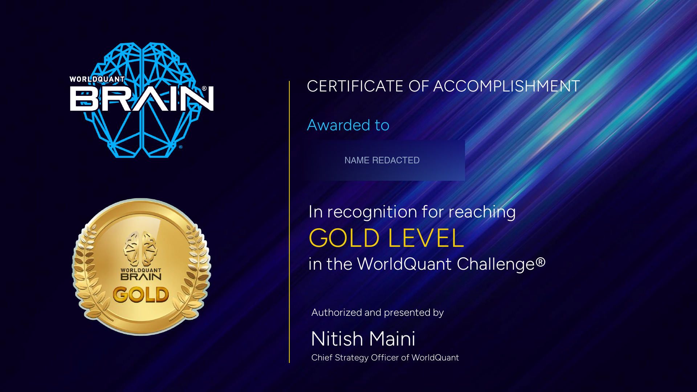

# ai-factor-lab

An auditable research operating system for AI-assisted factor mining — ledger,
preregistration, positive controls, and a synthetic platform you can run
end-to-end.

## Context

This framework was built during a personal research project on WorldQuant
BRAIN. The production instance talks to that platform; this repository does
not — everything here runs against a synthetic backend.

**Not affiliated with WorldQuant.** No platform data, alpha expressions,
account information, or credentials are included. This repository contains no
platform integration or automation.

## What this is

A small, runnable distillation of the machinery that keeps an AI-assisted
research loop honest. The interesting part is not the factor generation; it is
the record that makes every result traceable to a rule that existed before the
result did.

```
candidate expression + settings
             |
             v
      identity (SHA-256)
             |
             v
   ledger: candidates -> plans -> attempts -> observations -> outcomes
             ^                    |
             |                    v
     prereg (frozen)      synthetic platform
             |                    |
             +------> gates <-----+
                        |
                        v
                    classify
```

Five ideas, five modules:

| Idea | Module | Question it answers |
|---|---|---|
| Candidate fingerprint | `identity.py` | Is this the same candidate we already ran? |
| Ledger | `ledger.py` | What happened, in what order, under which rule? |
| Preregistration | `prereg.py` | What would have counted as success before we looked? |
| Gates | `gates.py` | Did it pass, fail, or was it not measured? |
| Outcome classification | `classify.py` | What kind of result is this? |

`examples/synthetic/` adds a deterministic world with 30 fields and a tiny
expression language. It is a seam, not a toy: the demo computes PnL from
positions taken before returns are realized.

## Why

A language model will produce a plausible expression, a plausible reading, and
a plausible explanation — in that order. The failure mode is not bad code. It
is a research record where a run that measured nothing is indistinguishable
from a run that measured a negative result.

Three concrete protections:

1. **Content-addressed identity.** The same candidate reached through different
   paths collapses onto one row. Changing one byte produces a different row.
2. **Terminal outcomes.** The database refuses to update or delete an outcome.
   A re-run is a new attempt, not an edit of history.
3. **Ternary gates.** Every gate returns `pass`, `fail`, or `not_measured`.
   Missing data can never be silently read as a failure.

## Core ideas

### Candidate fingerprint

Expressions are whitespace-normalized; settings are defaulted and uppercased.
The candidate ID is `CAND-` plus a SHA-256 over the canonical JSON of both.
Registration is idempotent. The prefix is presentation only — the hash is the
identity.

### Ledger

Five tables, one direction of flow. Outcomes are immutable at the schema level.
Observation IDs are content-addressed over the attempt and its metrics. SQLite
is used as a file format; nothing depends on a server.

### Preregistration

A preregistration is a typed decision rule: named gates, a closed outcome
vocabulary, and an explicit **not-measured slot for every gate**. It is hashed
before the first simulation, and the plan records the digest. You can still
change your mind later; you cannot pretend the rule was always different.

### Positive controls

A gate that never fires is not a gate. The demo includes a known-negative
candidate (`rank(f_29)`) built to have no linear edge, and a zero-variance
candidate (`rank(f_28)`) that must be classified as `operational_error`. The
run exits non-zero if the negative control is ever recognized.

### Three-layer verification

| Layer | Question | Judge | In this repository |
|---|---|---|---|
| Rule | Is the code and record structurally valid? | Machine | `tests/`, `scripts/check-*.py` |
| Criterion | Did this candidate pass the frozen rule? | Machine + written criteria | `gates.py`, `classify.py`, `docs/preregistration.md` |
| Effectiveness | Was the research worth doing? | Human and the world | Not automatable |

The third layer is the verification red line. No repository can decide it for
you.

## Quickstart

Requires Python 3.11+ and [uv](https://docs.astral.sh/uv/).

```bash
uv sync
uv run python examples/synthetic/run_demo.py
```

The run takes under a second and produces a table like:

```
expression                        sharpe fitness turnover  outcome
f_00                               4.006   3.767   0.485  recognized
-rank(f_00)                       -3.748  -3.369   0.390  effective_negative
rank(f_29)                         0.208   0.035   0.591  no_value
rank(f_28)                           n/a     n/a   0.000  operational_error
```

`rank(f_29)` is the negative control: it must not be recognized.
`rank(f_28)` is constant, so its Sharpe is undefined; it is recorded as
not measured rather than as a failure.

Run the rule layer yourself:

```bash
uv run pytest
uv run ruff check . && uv run ruff format --check .
uv run python scripts/check-structure.py
uv run python scripts/check-hygiene.py
```

## Outcome

**WorldQuant Challenge — Gold Level (2026).** Official certificate; name
redacted.

*The award is a platform recognition and does not imply endorsement of this
repository.*

The certificate image is `docs/assets/worldquant-gold.png`. It contains no
platform data, account information, or unredacted personal details.



## How this was built

The production system is larger and private because it contains account data
and a live platform adapter. This repository is a **rewrite around the same
invariants**, not an export. The mapping — what is the same logic, what was
replaced by a synthetic adapter, and what was deliberately left out — is in
[`docs/production-vs-repo.md`](docs/production-vs-repo.md).

A longer, incident-level account of what went wrong and what changed is in
[`docs/case-study.md`](docs/case-study.md).

## Human vs. AI

| Decision | Who |
|---|---|
| Which questions are worth asking | Human |
| Which hypotheses and fields to test | Human |
| Drafting the preregistered rule | AI drafts; human reviews and authorizes |
| Turning a hypothesis into candidate expressions | AI |
| Running the pipeline and recording results | AI |
| Deciding whether a result is worth acting on | Human |
| Changing a gate after seeing results | Human, with a written reason |
| Publishing a result | Human |

The system is designed around that split: AI can execute at volume, but it
cannot silently rewrite the rule or promote its own output.

## What this is not

- Not an alpha-mining bot, and not a source of trading signals.
- No platform integration, automation, credentials, or sessions.
- No real market data, expressions, alpha IDs, or account information.
- No investment advice.
- No support promise. Issues may be closed without action.

## License and security

Apache-2.0. See [`LICENSE`](LICENSE) and [`SECURITY.md`](SECURITY.md).
